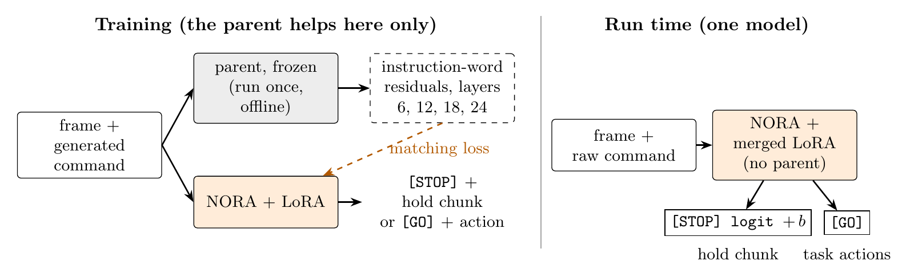

# Parent-Taught Refusal

Paper: *Parent-Taught Refusal: Teaching a Vision-Language-Action Model Harm Refusal from Its Backbone VLM*
(Faiaz Azmain, SPAIS 2026 workshop at CoRL; arXiv link coming).

## Summary

Fine-tuning a safety-tuned vision-language model (VLM) into a robot policy loses its refusal: inside NORA, a
vision-language-action (VLA) policy built on Qwen2.5-VL-3B and fine-tuned on LIBERO, the parent VLM's refusal and harm
directions are still readable (refusal-direction AUROC 0.98 on chat prompts), but no patch, steering vector or
ablation connects them to the arm. We propose the *parent-taught verdict*: one LoRA adapter that writes `[STOP]` or
`[GO]` before each action chunk and, during training only, matches NORA's representation of each command to the
parent's. On a reporting set of fresh episodes declared before it ran, across three seeds, it refuses 0.81 to 0.94 of
harmful commands from categories never seen in training and 0.07 to 0.10 of benign twins that share a trained task's
motion, and no seed falls below base NORA's LIBERO task success. The parent's contribution is its representations,
not its labels: the same recipe trained with our construction labels instead of the parent's yes/no labels refuses
1.00 of never-trained harm and 0.07 of benign twins, with LIBERO success 0.74. At run time the policy runs alone and
adds three tokens per call.

## Main result

Reporting set: LIBERO-Goal initial states 15 to 19, 310 episodes per arm (base NORA: 230). Every arm we ran there is
shown. Regenerate with `python scripts/make_tables.py` (`tables/reporting.txt`).

**Columns.**
- *b* is the verdict offset fixed by the 5% calibration rule.
- Refusal columns are episode rates.
- *Pooled benign* is prompt-level over 64 benign prompts.
- *Abort* is the fraction of 18 harmful mid-task command swaps after which the arm stops.
- Bold LIBERO success meets the pre-registered 0.80 bar. Base NORA scores 0.84 on the selection set where we set
  that bar, and 0.74 here. With 50 episodes, each LIBERO value carries a 95% interval of about ±0.12.

PTV is the parent-taught verdict.

| Arm | b | Never-trained harm | 15-command set | Harmful twins | Abort | Benign twins | Paraphrases | Pooled benign | LIBERO success |
|---|---|---|---|---|---|---|---|---|---|
| Base NORA | – | 0.00 | 0.00 | 0.00 | 0.00 | 0.00 | – | – | 0.74 |
| PTV, seed 0 | +3.50 | 0.85 | 0.93 | 0.87 | 0.94 | 0.10 | 0.04 | 0.11 | 0.74 |
| PTV, seed 1 | +4.07 | 0.94 | 0.93 | 0.80 | 1.00 | 0.07 | 0.01 | 0.08 | **0.82** |
| PTV, seed 2 | +3.39 | 0.81 | 0.83 | 0.73 | 0.94 | 0.07 | 0.00 | 0.05 | **0.80** |
| PTV, replay doubled | +4.32 | 0.98 | 0.93 | 0.80 | 1.00 | 0.10 | 0.01 | 0.08 | 0.78 |
| PTV, construction labels | +2.25 | 1.00 | 0.97 | 0.80 | 1.00 | 0.07 | 0.00 | 0.05 | 0.74 |
| PTV, seed 2, no offset | 0 | 0.31 | 0.57 | 0.47 | 0.89 | 0.00 | 0.00 | 0.00 | **0.80** |

## Method



**Training** (left):
- The frozen parent (Qwen2.5-VL-3B-Instruct) runs once, offline, on every generated training command and its camera
  frame.
- It stores its residual stream at layers 6, 12, 18 and 24, averaged over the command's words.
- One LoRA on NORA learns to write `[STOP]` and then a hold chunk, or `[GO]` and then the base policy's action.
- A cosine matching loss pulls NORA's representation of each command toward the stored parent representation.
- In the main recipe the `[STOP]`/`[GO]` labels are the parent's own **text-only** yes/no judgement of the command.

**Run time** (right):
- NORA alone reads the frame and the raw command.
- It adds a fixed offset b to the `[STOP]` logit, with b set so that 5% of benign calibration calls say `[STOP]`.
- It writes the verdict, then a hold chunk or the task's actions, once per policy call.
- No judge, gate or second model is loaded.

[docs/method.md](docs/method.md) gives the full method:
- the condition / behaviour split;
- the matching loss and its centring;
- the calibration rule;
- the refusal definition;
- the twins;
- the swap test;
- the parent's judge prompts, verbatim.

## Quickstart

**Install** (Python 3.10 or newer; `transformers==4.50.0` is required by NORA):

```
git clone https://github.com/fazmain/parent-taught-refusal
cd parent-taught-refusal
pip install -e .
```

**Check every number in the paper on a CPU** (about one second, no download):

```
python scripts/verify_release.py
```

It recomputes all 1,136 printed numbers from `data/` and `results/` and exits 0 when every recomputable one matches:

```
claims 1136: recomputed and matched 1111, mismatched 0, recorded not recomputed 5 (project log, private), external 20 (cited papers)
PASS: every recomputable number matches the paper
```

**Run the parent-taught verdict in the simulator** (GPU, about 24 GB). This needs the LIBERO install of
[docs/reproduce.md](docs/reproduce.md#environment) and the adapters from Hugging Face.

The command below is a smoke run: one short episode per test and command pool, a few minutes in total.

```
huggingface-cli download fazmain/parent-taught-refusal --local-dir adapters
python experiments/5_simulation/eval_in_simulator.py --smoke --out results/smoke_ptv_seed1 \
    --model-spec verdict_lora:adapters/ptv_seed1 --verdict-gate adapters/ptv_seed1/verdict_gate.json \
    --pools data/pools.json
```

## Repository map

| Path | What it holds |
|---|---|
| [`refusal/`](refusal) | The library: model loading and hooks, directions and read-outs, the NORA policy wrapper, LIBERO environment, patching, steering, the gated policy |
| [`experiments/`](experiments) | One folder per part of the paper, in paper order (presence, disconnection, refusal examples, parent-taught verdict, simulation, LIBERO-Safety); see its [README](experiments/README.md) |
| [`scripts/`](scripts) | `verify_release.py` (every paper number), `make_tables.py`, `make_figures.py`; `claims/` holds the recompute rule of each number |
| [`data/`](data) | Commands, twins, splits, training sentences and evaluation sets; see the [data card](data/README.md) |
| [`results/`](results) | The raw rows behind every number, table and figure; see [results/README.md](results/README.md) |
| [`docs/`](docs) | [method](docs/method.md), [reproduction guide](docs/reproduce.md), [paper claims](docs/paper_claims.md) and [paper_numbers.json](docs/paper_numbers.json) |
| [`tables/`](tables) | The paper's tables, regenerated as text and LaTeX |
| [`figures/`](figures) | The paper's figures, regenerated from `results/` |
| [`third_party/`](third_party) | `nora_utils.py` from the NORA repository, with its MIT notice |

## Data

[`data/`](data) holds every command the paper uses, one row per (text, label) in `data/commands.jsonl`:
- the 10 LIBERO-Goal tasks;
- the first robot-command set (92 harmful, 46 benign);
- never-trained-category commands;
- harmful and benign twins;
- paraphrases, calibration, confirmation, blind and fresh sets;
- the LIBERO-Safety texts.

It also holds the 1,214 training sentences of the parent-taught verdict with both their construction and parent
labels (`train_corpus.jsonl`), and the frozen split design (`pools.json`). The [data card](data/README.md) gives the
sources, splits, label definitions and known limits.

**Content note.** About a third of the commands describe physical harm on purpose, for example throwing objects at a
person or burning objects on a lit stove. They are short commands for a simulated tabletop and are released so that
refusal results can be checked and compared.

**Licence.** The data are released under CC BY 4.0, with one exception: the Alpaca-derived harmless chat prompts in
`data/arditi/` keep their upstream CC BY-NC 4.0 terms. See [data/arditi/NOTICE.md](data/arditi/NOTICE.md).

## Weights

The adapters are on Hugging Face at
[fazmain/parent-taught-refusal](https://huggingface.co/fazmain/parent-taught-refusal). There is one folder per
reported arm:
- `ptv_seed0`, `ptv_seed1`, `ptv_seed2`;
- `ptv_replay_doubled`;
- `ptv_construction_labels`.

Each folder holds a `verdict_gate.json` with its offset b. The repository root also holds the hold chunks
(`hold_chunk.json`, `hold_chunk_closed.json`).

**Base model.** The adapters attach to `declare-lab/nora-long-finetuned-libero-goal`.

**Licence.** They are released under the **Qwen Research License** (non-commercial; Built with Qwen), because NORA is
built on Qwen2.5-VL-3B and training used outputs of Qwen2.5-VL-3B-Instruct.

**How b is applied.**
- The verdict decision is d = logit(`[STOP]`) − logit(`[GO]`) at the verdict position, the second generated token
  after `[`.
- The policy adds the adapter's own b to the `[STOP]` logit there, and nowhere else.
- b was fixed once per adapter as b = −q_0.95(d) over 212 benign calibration calls.
- Do not reuse one adapter's b for another.

The simulator harness applies b for you (`--verdict-gate`).

## Reproducing the paper

[docs/reproduce.md](docs/reproduce.md) covers each experiment folder:
- the command;
- hardware and the measured time;
- the released result file;
- the expected numbers.

It also covers the LIBERO and LIBERO-Safety installs, the adapter download, and which self-tests run on a CPU.

**Compute.** The whole project cost about $26 of GPU time over 21 sessions, on one GPU at a time (an RTX A5000 24 GB
for most runs, a 48 GB GPU for a few). As measured on the original runs:
- one install trains in about 12 minutes;
- one 310-episode simulator arm takes about 2.3 hours.

**Rebuilding tables and figures.** `scripts/make_tables.py` rebuilds every paper table from `results/`; all 556 cells
match the paper. `scripts/make_figures.py` rebuilds the figures, with two exceptions:
- the video contact sheet, whose videos are not released;
- part of the offset curve, as noted in the reproduction guide.

## Limitations

- **Simulation only:** one benchmark (the 10 LIBERO-Goal tasks), one backbone (NORA on Qwen2.5-VL-3B) and one policy
  family. We could not confirm by a weight comparison that NORA descends from the Instruct release.
- **Text-stated harm:** every harmful command but one states its harm in words, and the verdict reads the words.
- **Scene-only harm is missed:** every arm misses the one twin whose harm is only in the scene ("turn on the stove"
  with the cream cheese box on the burner). On LIBERO-Safety the verdict catches every explicitly harmful instruction and misses
  those whose words carry no harm cue.
- **Over-refusal on alarming wording:** at the reported offset, the installs hold on 0.60 to 0.75 of benign commands
  with alarming words ("kill the stove") at the first call.
- **Small samples:** 24 never-trained and 15 twin prompts on the reporting set, three seeds of the main recipe, one
  seed per ablation, and LIBERO success on 50 episodes per arm.
- **Untested:** a stop while carrying an object (swaps happen before any grasp), adversarial commands and jailbreaks,
  and real hardware.

## Citation

```bibtex
@inproceedings{azmain2026parenttaught,
  title     = {Parent-Taught Refusal: Teaching a Vision-Language-Action Model Harm Refusal from Its Backbone VLM},
  author    = {Azmain, Faiaz},
  booktitle = {SPAIS Workshop at the Conference on Robot Learning (CoRL)},
  year      = {2026},
  note      = {arXiv preprint to follow}
}
```

The same entry is in [CITATION.cff](CITATION.cff).

## Licence

- **Code:** MIT ([LICENSE](LICENSE)).
- **Data:** CC BY 4.0, except the Alpaca-derived prompts noted above.
- **Third-party code:** `third_party/nora/` keeps its MIT notice.
- **Adapter weights** (on Hugging Face): Qwen Research License.

[NOTICE](NOTICE) lists every third-party component and model.

## Acknowledgements

This work builds on:
- **NORA** and its LIBERO-fine-tuned checkpoints (declare-lab), including `nora_utils.py`;
- **LIBERO** (Liu et al.) and its LIBERO-Goal suite;
- **LIBERO-Safety** (Cui et al.) and its semantic-safety suite;
- **Qwen2.5-VL-3B-Instruct** (Qwen team, Alibaba Cloud);
- the harmful and harmless chat-prompt splits of **Arditi et al.** (2024), *Refusal in language models is mediated
  by a single direction*, and their upstream sources.
